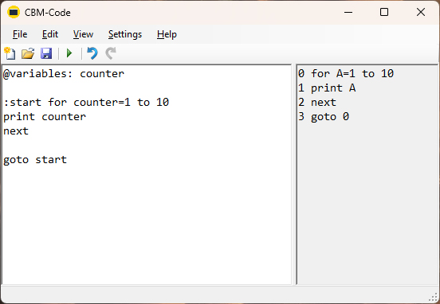

# Commodore BASIC Code Editor

A simple text editor for editing macro enhanced Commodore BASIC code, and exporting it as runnable source code.

## Editor features

- Load/save source files
- Multiple compile targets: VIC-20 (first version), Commodore 64, Commodore 128 40 columns, Commodore 128 80 columns
- Export runnable code

## Language extensions

- Labels instead of line numbers
- Long variable names
- Constant values
- Compound assignment

## Other features

- Check for declared variables
- Check that exported code lines not are longer than the maximum length
  - VIC-20: 88 characters
  - Commodore 64: 80 characters
  - Commodore 128: 160 characters

## Screenshot

# Rules

This is how you use the extended macro features of the language:

* Undeclared variables cannot be used
* All variables (long names allowed) must be declared using the `@variables` macro
* [Labels written on the same line as the following code will be anonymous](https://github.com/Anders-H/CbmCodeEdit/blob/main/Examples/labels/hello_world_v1.md)
* [Labels written on an own line will keep their name in the evaluated code](https://github.com/Anders-H/CbmCodeEdit/blob/main/Examples/labels/hello_world_v2.md)
* Everything else is copied unchanged to the output
